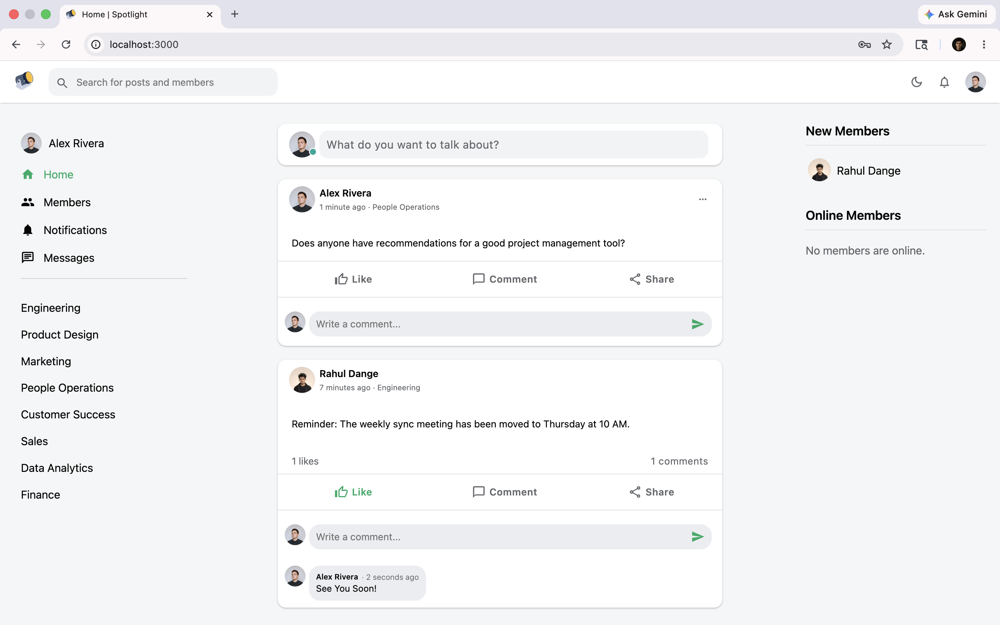
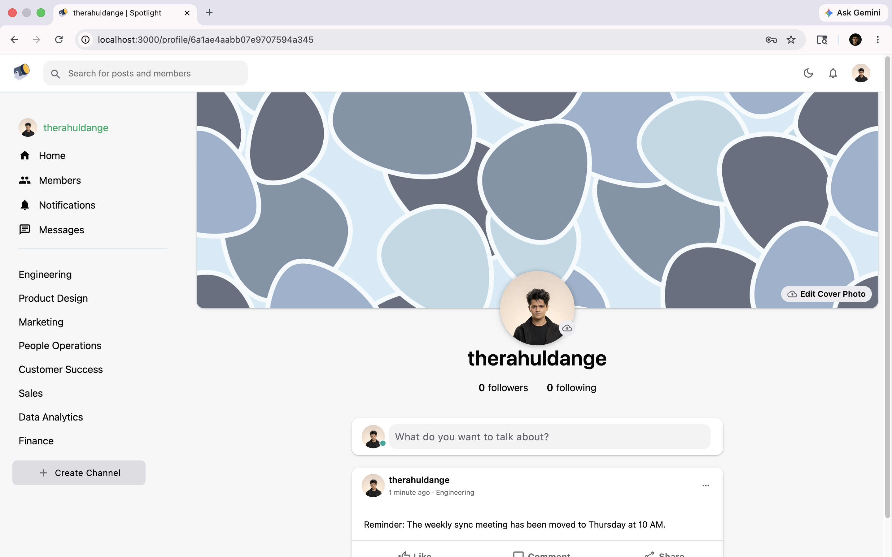
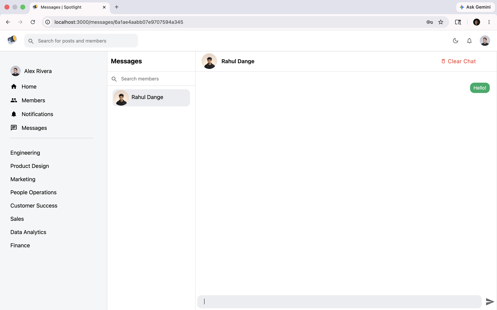
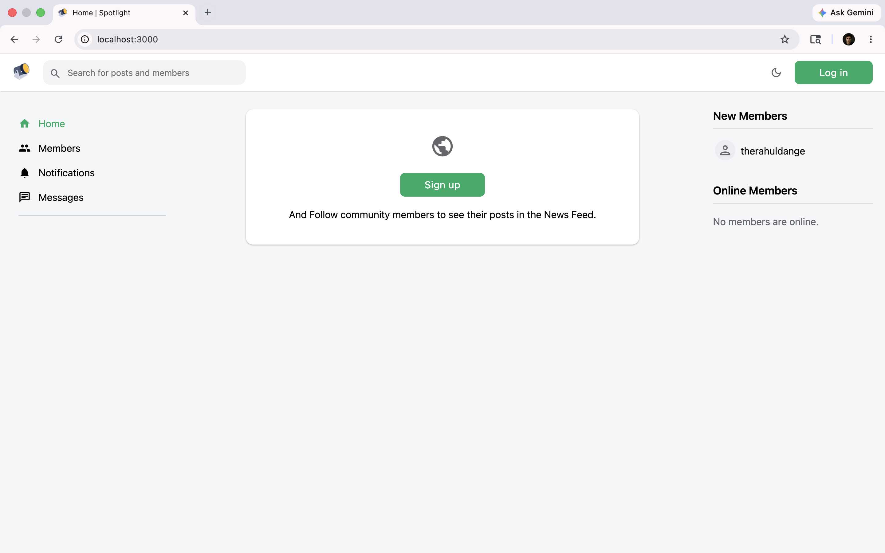
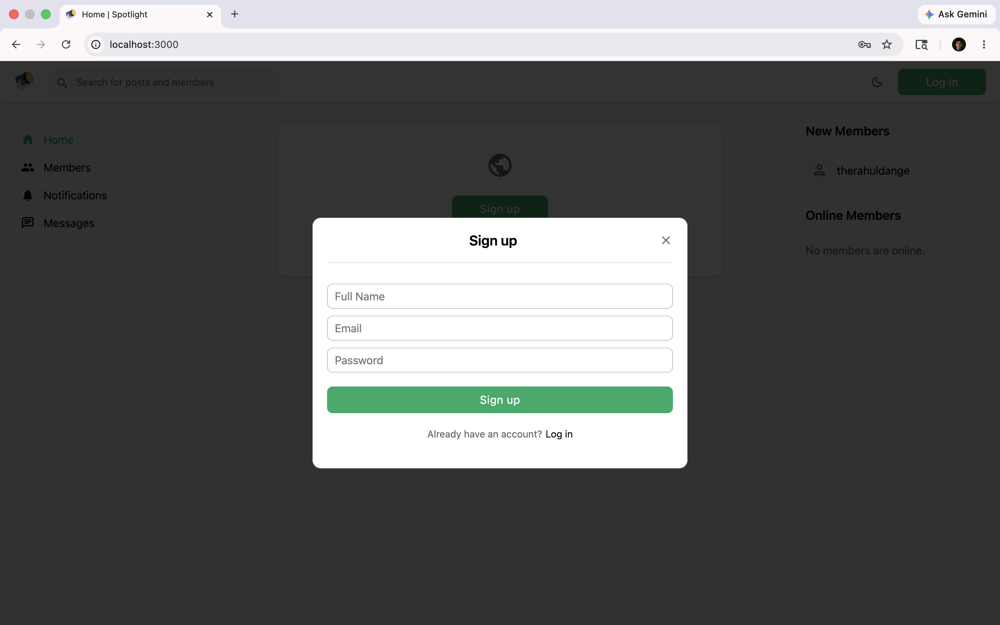
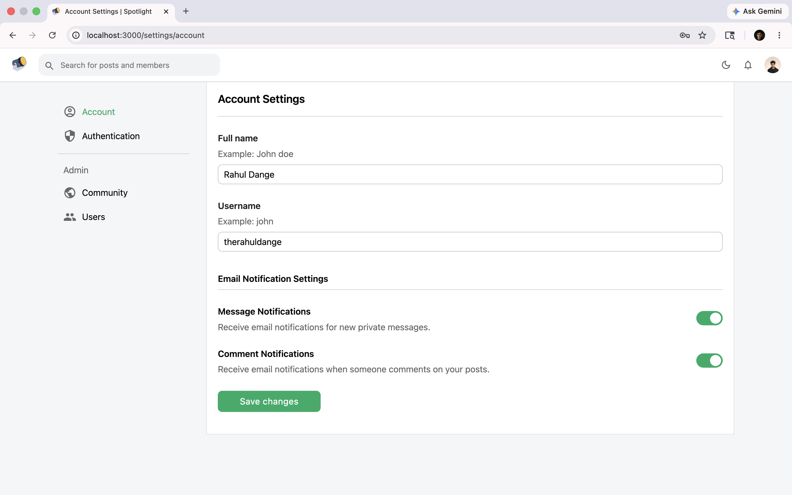
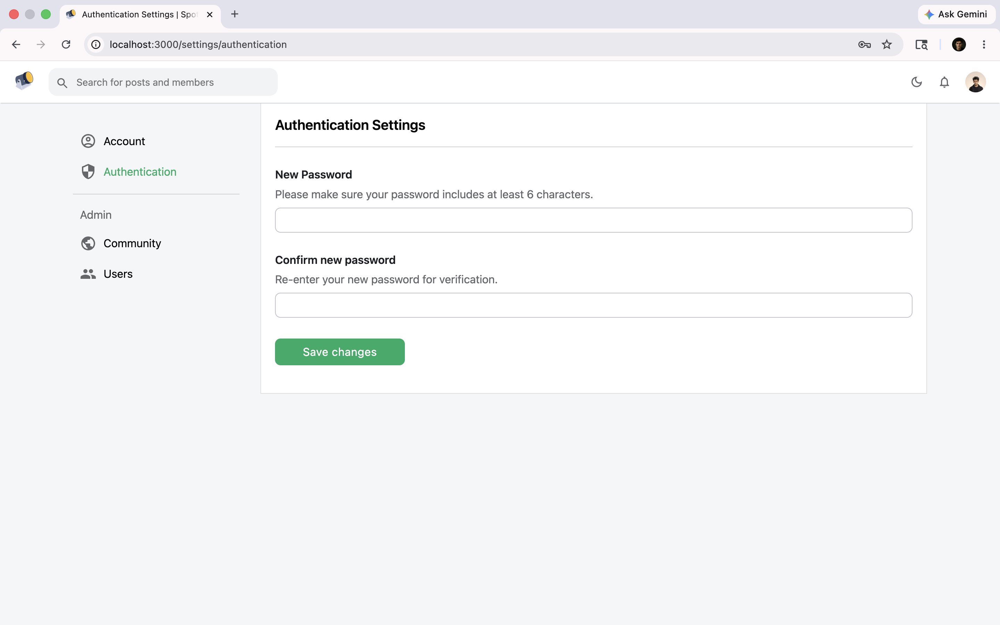

<p align="center">
  
</p>

<h1 align="center">Spotlight</h1>

<p align="center">[](https://github.com/rahuldangeofficial/12-spotlight-interaction-platform/actions/workflows/ci.yml)</p>

<p align="center">
  <strong>An Open-Source Interaction Platform for Small Communities</strong>
</p>

<p align="center">
  
  
  
</p>

---

## Overview

**Spotlight** is a powerful, lightweight, and fully customizable interaction platform designed for small-scale communities (up to 100 members). Whether it's a private hobby group, a small school department, or a local club — Spotlight provides a premium space for members to connect, share, and engage without the clutter of massive social networks.

Built as a monorepo with **Next.js**, **Express**, and **MongoDB**, it offers real-time messaging, customizable channels, role-based access control, and a clean, modern UI out of the box.

---

## Screenshots

### Home Feed


### User Profile


### Private Messages


### Guest View


### Sign Up


### Account Settings


### Authentication Settings


---

## Features

- **News Feed** — Follow community members and see their posts in a personalized feed with likes, comments, and sharing.
- **Customizable Profiles** — Personal bios, cover photos, and avatars to showcase each member's identity.
- **Dynamic Channels** — Create and organize topic-based discussion spaces (Engineering, Marketing, Sales, etc.).
- **Real-Time Private Messaging** — Instant direct communication between community members via Socket.io.
- **Real-Time Notifications** — Stay updated with interactions, mentions, and new messages instantly.
- **White-Label Customization** — Admins can change the community name, logo, and primary color from Settings.
- **Secure Authentication** — JWT-based authentication with role-based access control (SuperAdmin / Admin / Member).
- **Dark Mode** — Built-in theme toggle for a comfortable viewing experience.
- **Search** — Search across posts and members instantly.
- **Email Notifications** — Configurable email alerts for new messages and comments via Mailgun.

---

## Tech Stack

| Layer        | Technology                                              |
| ------------ | ------------------------------------------------------- |
| **Frontend** | Next.js 12, React 17, Styled Components, Redux, React Query, MUI 5 |
| **Backend**  | Node.js, Express, Passport.js, JWT, Socket.io           |
| **Database** | MongoDB (Mongoose 5)                                    |
| **Infra**    | Lerna (Monorepo), PM2 (Production), Husky (Git Hooks)   |
| **Services** | Cloudinary (Image Uploads), Mailgun (Emails)            |

---

## Getting Started

### Prerequisites

- [Node.js](https://nodejs.org/) v16 or higher
- [Yarn](https://yarnpkg.com/) v1 (Classic)
- [MongoDB](https://www.mongodb.com/) running locally or a remote connection string

### 1. Clone the Repository

```bash
git clone https://github.com/therahuldange/spotlight.git
cd spotlight
```

### 2. Install Dependencies

```bash
yarn install
```

### 3. Configure Environment Variables

```bash
cp packages/api/.env.example packages/api/.env
```

Open `packages/api/.env` and fill in your configuration:

| Variable                 | Description                                      |
| ------------------------ | ------------------------------------------------ |
| `MONGO_URL`              | MongoDB connection string                        |
| `SECRET`                 | JWT signing secret (use a strong random string)  |
| `CLOUDINARY_CLOUD_NAME`  | Cloudinary cloud name for image uploads          |
| `CLOUDINARY_API_KEY`     | Cloudinary API key                               |
| `CLOUDINARY_SECRET`      | Cloudinary API secret                            |
| `MAILGUN_API_KEY`        | Mailgun API key for email notifications          |
| `MAILGUN_DOMAIN`         | Mailgun domain                                   |

### 4. Create the Super Admin Account

```bash
yarn create-super-admin your-email@example.com
```

This creates the first administrative account. Default password: `therahuldange` (change it after first login from Settings > Authentication).

### 5. Start Development Servers

```bash
yarn dev
```

This starts both the API server (`http://localhost:4000`) and the Next.js frontend (`http://localhost:3000`) concurrently.

---

## Production Deployment

### Build for Production

```bash
yarn build
```

### Start Production Servers

```bash
yarn start
```

### Using PM2 (Recommended)

```bash
pm2 start pm2.config.json
```

---

## Project Structure

```
spotlight/
├── packages/
│   ├── api/                    # Express backend
│   │   ├── src/
│   │   │   ├── controllers/    # Route handlers
│   │   │   ├── db/             # Database queries
│   │   │   ├── models/         # Mongoose schemas
│   │   │   ├── utils/          # Helpers (email, uploads)
│   │   │   ├── routes.ts       # API route definitions
│   │   │   ├── socket.ts       # Socket.io event handlers
│   │   │   └── index.ts        # Server entry point
│   │   └── .env.example        # Environment template
│   │
│   └── frontend/               # Next.js frontend
│       ├── components/         # Reusable React components
│       ├── pages/              # Next.js page routes
│       ├── store/              # Redux store
│       ├── utils/              # Custom hooks & helpers
│       └── theme.ts            # Theme configuration
│
├── branding/                   # Logo and favicon assets
├── screenshots/                # Application screenshots
├── pm2.config.json             # PM2 production config
├── lerna.json                  # Monorepo configuration
└── package.json                # Root workspace config
```

---

## Roles and Permissions

| Role           | Capabilities                                                       |
| -------------- | ------------------------------------------------------------------ |
| **SuperAdmin** | Full access: manage users, channels, community settings, and all content |
| **Admin**      | Moderate content, manage channels, manage members                  |
| **Member**     | Create posts, comment, like, message, and follow other members     |

---

## Contributing

Contributions are welcome! If you have suggestions for new features or find any bugs, feel free to open an issue or submit a pull request.

1. Fork the repository
2. Create a feature branch (`git checkout -b feature/amazing-feature`)
3. Commit your changes (`git commit -m 'Add amazing feature'`)
4. Push to the branch (`git push origin feature/amazing-feature`)
5. Open a Pull Request

---

## License

This project is licensed under the [MIT License](LICENSE).

---

<p align="center">
  Crafted with care by <strong><a href="https://github.com/therahuldange">Rahul Dange</a></strong>
</p>
